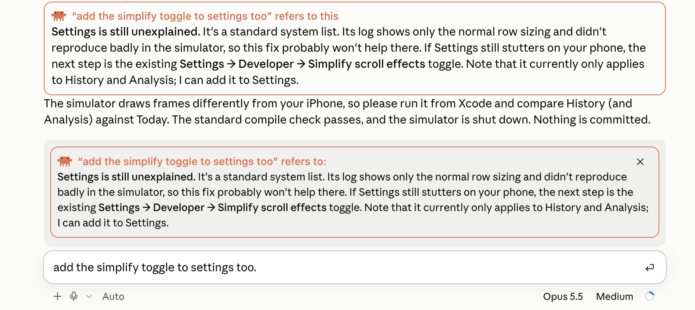
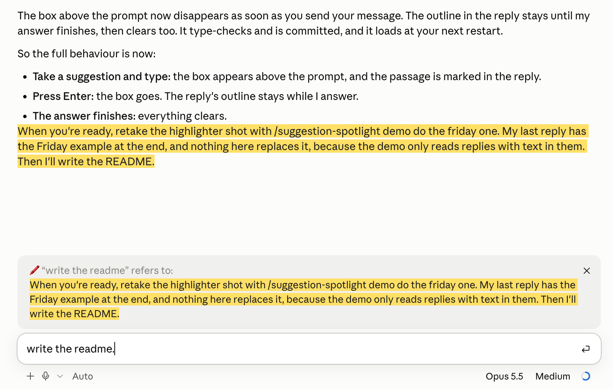

# Suggestion Spotlight

**See what Claude's suggestion is pointing at before you send it.**

After a reply, Claude Code often suggests your next message in the prompt box: *"do the Friday one"*, *"go with option 2"*, *"add the toggle to Settings too"*. Press Tab and it's yours. But which Friday one? If the reply was long, you scroll back up and reread it to find out what you're agreeing to.

Suggestion Spotlight finds it for you. Take a suggestion, and the passage it refers to is marked where it sits in the reply and quoted in a box just above the prompt, right where you're about to press Enter.



## Two styles

**claude** (the default): a clay-orange box headed by Clawd, the pixel crab.

**highlighter**: no box. The passage is marked like a highlighter pen, in yellow with dark text, so it reads the same in light and dark mode.



Switch at any time with `/suggestion-spotlight style highlighter` or `/suggestion-spotlight style claude`.

## How it behaves

- **Take a suggestion** (Tab), then type anything, even a space. The spotlight appears.
- **Press Enter** and the box above the prompt goes, since you've made your choice. The mark in the reply stays while Claude answers, then clears.
- **Type something else instead** and the spotlight hides; clear the box and it comes back. Your own typing never triggers it.
- **Generic suggestions** such as "okay, let me know when it's done" point at nothing specific, so nothing is marked.
- **Press ✕** on the box to dismiss it.

## Install

In a Claude Code terminal session:

```
/plugin install suggestion-spotlight --marketplace C-M-Jones/suggestion-spotlight
```

Answer `y` to add the marketplace and pick the user scope. It's active straight away.

**Desktop app, or loading it by hand:** clone the repo and add the folder to the `env` block of `~/.claude/settings.json`. Separate several mod folders with `:`, and append to the variable rather than replacing it if it's already set.

```bash
git clone https://github.com/C-M-Jones/suggestion-spotlight.git ~/suggestion-spotlight
```

```json
{
  "env": {
    "CLAUDE_CODE_PLUGIN_DIRS": "~/suggestion-spotlight/suggestion-spotlight"
  }
}
```

Then restart Claude Code. `git pull` in the clone updates it.

## Commands

| Command | What it does |
| --- | --- |
| `/suggestion-spotlight` | Turn it on or off. The choice is remembered across sessions. |
| `/suggestion-spotlight on` / `off` | The same, explicitly. |
| `/suggestion-spotlight style claude` / `highlighter` | Switch the look. |
| `/suggestion-spotlight demo` | Spotlight the last list item of the reply above, to see the current style. |
| `/suggestion-spotlight demo <text>` | Run the real lookup as if `<text>` were the suggestion you took. Handy when Claude hasn't offered one. |

## Settings

In `/config`:

| Setting | Options | Default |
| --- | --- | --- |
| Spotlight style | `claude`, `highlighter` | `claude` |
| Where to spotlight | `both`, `above-prompt`, `in-reply` | `both` |
| Lookup model | `haiku`, `sonnet` | `haiku` |

## How it works, and what it costs

When you take a suggestion, the mod splits the reply into numbered blocks (sentences, list items, whole tables and code blocks) and asks a small model which one block the suggestion points at. It gets back a number, not text. A heading that ends in a colon brings the list beneath it along, so "do step 1" marks the whole step.

- **Cost:** one small Haiku call each time you take a suggestion, on your own Claude plan. At most about 16,000 characters of a reply are sent, taken from the end, since that's where options usually are. If the call fails, it falls back to matching keywords.
- **Privacy:** the reply text goes only to the model your Claude Code session already uses. Nothing else leaves your machine.
- **The desktop app** shows suggestions without telling mods. So the mod notices instead when the prompt box suddenly holds a phrase you never typed, which is what Tab does. That's why you type one key after Tab. Text dictated into the box can occasionally be read the same way.

## Requirements

Claude Code with mods (function hooks), an early-access API. Built and tested on Claude Code 2.1.293 in the desktop app. The terminal uses Claude Code's own suggestion event instead and hasn't been tested as thoroughly. The API may change between releases.

## Licence

MIT. See [LICENSE](LICENSE).

Made by [Cael Jones](https://github.com/C-M-Jones). If you use or build on this, a credit or a link back is appreciated.
